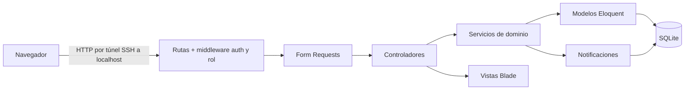
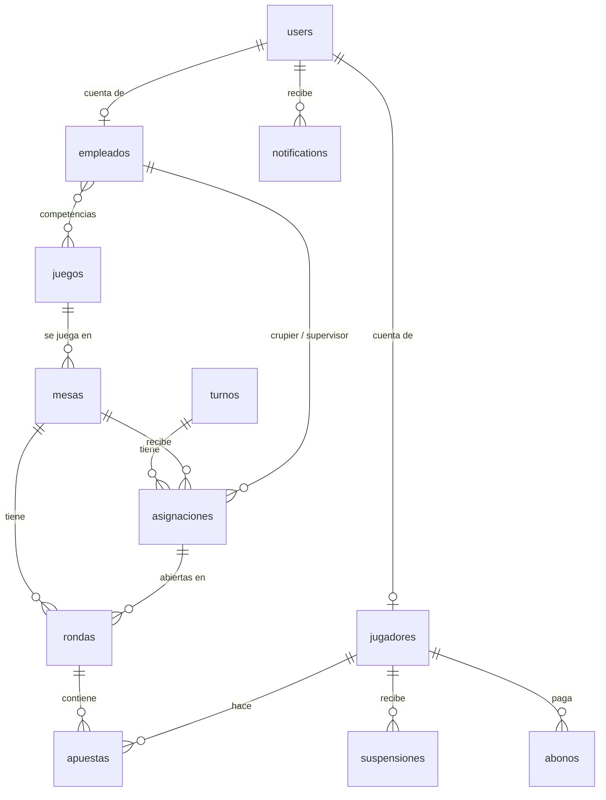

# Documento técnico — Proyecto Casino con Laravel

Asignatura: Bases de Datos, Administración y Aplicaciones (Pontificia Universidad Javeriana).

Integrantes: Juan David Ramírez, Alejandro Doncel y Dana Katalina Díaz.

Este documento describe el framework usado, la arquitectura, el modelo de datos, las funcionalidades implementadas y las dificultades encontradas. La trazabilidad completa entre cada requisito, su implementación y sus pruebas está en [matriz-cumplimiento.md](matriz-cumplimiento.md).

## 1. El framework: Laravel

Laravel es un framework web de PHP que sigue el patrón Modelo-Vista-Controlador. Se usó la versión 13 sobre PHP 8.4. Las piezas de Laravel que usa el proyecto son:

| Pieza | Para qué se usa en el proyecto |
|---|---|
| Rutas y middleware | Cada URL se declara en `routes/web.php`. Los grupos `auth` exigen sesión y el middleware propio `rol` restringe cada grupo de rutas a uno o varios roles. |
| Controladores | Reciben la petición, llaman a la lógica de negocio y devuelven una vista o una redirección. |
| Form Requests | Validan los datos de cada formulario antes de llegar al controlador, con mensajes en español (`lang/es/validation.php`). |
| Eloquent | Modelo objeto-relacional: cada tabla tiene su modelo (`Mesa`, `Ronda`, `Apuesta`…) con sus relaciones (`belongsTo`, `hasMany`, `belongsToMany`). |
| Migraciones | Definen el esquema de la base de datos en código versionado, con claves foráneas, índices únicos y restricciones `CHECK` (columnas `enum`). |
| Blade | Motor de plantillas de las vistas. Un layout común y un menú por rol. |
| Notificaciones | Avisos dentro de la aplicación guardados en la tabla `notifications` (canal `database`). |
| Pruebas | PHPUnit con las utilidades de Laravel para peticiones HTTP, sesión, base de datos en memoria y viaje en el tiempo (`travelTo`). |

No se añadió ningún paquete al esqueleto oficial de Laravel. Se retiraron Vite y npm porque la interfaz usa un único CSS propio (`public/css/app.css`) y un único archivo de JavaScript sin dependencias (`public/js/zk.js`).

## 2. Arquitectura

- **Capa web**: rutas, middleware, Form Requests, controladores y vistas. Los controladores son delgados: validan con el Form Request, comprueban la pertenencia (por ejemplo, que el crupier opere su propia mesa) y delegan.
- **Servicios de dominio** (`app/Services`): concentran las reglas que cruzan varias entidades y se ejecutan dentro de transacciones de base de datos.

  | Servicio | Responsabilidad |
  |---|---|
  | `AutenticacionZeroKnowledge` | Verifica la respuesta al desafío del inicio de sesión. |
  | `AsignacionService` | Valida y crea asignaciones de crupier y supervisor (RN-04, RN-05, RN-08). |
  | `ApuestaService` | Registra, modifica y anula apuestas con las validaciones de mínimo, máximo, saldo y autorización (RN-10, RN-11, RN-13). |
  | `ResultadoService` | Cierra rondas y resuelve cada apuesta: premio, saldo y consolidado del casino (RN-12). |
  | `AutorizacionJugadorService` | Decide si un jugador puede apostar y aplica las suspensiones automáticas (RN-14 a RN-18). |

- **Modelo**: modelos Eloquent y enums de PHP para los valores cerrados (`Rol`, `Concepto`, `EstadoApuesta`, `MotivoSuspension`).
- **Datos**: migraciones de Laravel sobre SQLite.

### Autenticación «Zero Knowledge» con SHA-256

El enunciado pide almacenar las contraseñas con SHA-256 y autenticar «Zero Knowledge». El servidor nunca recibe la contraseña:

1. **Al crear o cambiar una contraseña**, el navegador calcula `SHA-256(contraseña)` con la API Web Crypto y envía solo ese valor. El servidor guarda ese hash de 64 caracteres hexadecimales en `users.password`.
2. **Al iniciar sesión**, el servidor genera un desafío aleatorio de un solo uso (nonce de 256 bits) y lo guarda en la sesión.
3. El navegador calcula `h = SHA-256(contraseña)` y envía `respuesta = SHA-256(h + nonce)`. El campo de contraseña del formulario no tiene atributo `name`, así que la contraseña nunca viaja.
4. El servidor calcula `SHA-256(hash_guardado + nonce)`, lo compara en tiempo constante (`hash_equals`) y borra el nonce, de modo que una respuesta capturada no se puede reutilizar.
5. Si coincide, Laravel inicia la sesión y regenera su identificador.

Web Crypto solo existe en contextos seguros (`https` o `localhost`). Por eso la aplicación se usa a través de un túnel SSH hacia `localhost`.

### Autorización por rol

Cada grupo de rutas lleva el middleware `rol:<roles>`, que responde 403 si el rol no corresponde. Además, los controladores comprueban la pertenencia:

- un crupier solo opera la mesa que tiene asignada en el turno en curso;
- un supervisor solo emite conceptos de sus asignaciones y solo ve las ganancias de las rondas que supervisó;
- un jugador solo ve su propia cuenta, su historial y sus notificaciones.

El menú de cada rol muestra solo sus opciones, pero la seguridad no depende del menú.

## 3. Modelo de datos

| Tabla | Columnas principales | Restricciones e integridad |
|---|---|---|
| `users` | `username`, `password` (SHA-256 hex), `rol` | `username` único; `rol` limitado a los cuatro roles. |
| `empleados` | `user_id`, `documento`, `nombre_completo`, `salario_mensual` | `user_id` y `documento` únicos. |
| `juegos` | `nombre`, `registro_detallado` | Ruleta y Blackjack con registro detallado; Póker sin él. |
| `competencias` | `empleado_id`, `juego_id` | Clave primaria compuesta; qué juegos conoce cada empleado (RN-08). |
| `jugadores` | `user_id`, `codigo_cliente`, `documento`, `nombre_completo`, `edad`, `saldo` | Código, documento y cuenta únicos; edad ≥ 18 (RN-01, RN-02). |
| `mesas` | `codigo`, `juego_id`, `apuesta_minima`, `apuesta_maxima` | Código único; mínimo ≤ máximo (RN-03). |
| `turnos` | `fecha`, `hora_inicio`, `hora_fin` | Máximo 2 horas, sin cruzar medianoche ni solaparse (RN-06). |
| `asignaciones` | `turno_id`, `mesa_id`, `crupier_id`, `supervisor_id`, `concepto` | Únicos (turno, mesa) y (turno, crupier); `concepto` limitado a los cuatro valores (RN-04, RN-07). |
| `rondas` | `mesa_id`, `asignacion_id`, `numero`, `hora_inicio`, `hora_cierre`, `resultado` | Único (mesa, número): numeración correlativa por mesa (RN-09). |
| `apuestas` | `ronda_id`, `jugador_id`, `tipo_apuesta`, `monto`, `factor_pago`, `estado`, `premio`, `resuelta_en` | `estado` limitado a Pendiente, Ganada o Perdida (RN-10, RN-12). |
| `suspensiones` | `jugador_id`, `motivo`, `inicio`, `fin` | Motivo: pérdida diaria, pausa voluntaria, pérdida de empleado o investigación (RN-14 a RN-18). |
| `abonos` | `jugador_id`, `monto` | Pagos de la deuda de un empleado (RN-17). |
| `notifications` | `notifiable`, `data`, `read_at` | Tabla estándar de Laravel. |

Las claves foráneas usan `restrict`: no se puede borrar una mesa, un empleado, un jugador o una asignación que tenga historial. La aplicación lo comprueba antes y muestra un mensaje claro.

Los importes se guardan como `decimal(14,2)` y se calculan con BCMath, para no acumular errores de coma flotante en los saldos.

## 4. Funcionalidades implementadas

### Casos de uso

| Caso de uso | Quién | Qué hace |
|---|---|---|
| CU-01 Gestión de mesas | Administrador y Supervisor | CRUD de mesas; turnos diarios; asignación de crupier y supervisor por turno con todas las restricciones; concepto del supervisor al terminar el turno. |
| CU-02 Gestión de rondas | Crupier | Abrir una ronda con número correlativo, anular una ronda abierta sin apuestas y cerrarla con su resultado. Solo una ronda abierta por mesa. |
| CU-03 Gestión de apuestas | Crupier | Registrar, modificar y anular apuestas pendientes con validación estricta de mínimo, máximo, saldo y autorización. En póker, las apuestas se registran después del resultado. |
| CU-04 Gestión de ganancias | Sistema, Administrador y Supervisor | Al cerrar la ronda, cada apuesta queda Ganada (premio = monto × factor, acreditado al momento) o Perdida (monto consolidado a favor del casino). Consulta de ganancias por mesa y fechas. |

### Funcionalidades adicionales

| Funcionalidad | Qué hace |
|---|---|
| Interfaz de usuario | Vistas Blade responsive con menú por rol, mensajes de éxito y error y validación en español. |
| Notificaciones | Avisos dentro de la aplicación: resultado de cada apuesta, suspensiones automáticas, reactivaciones y conceptos de «Sospecha de fraude». |
| Gestión de empleados | CRUD de empleados con cuenta de acceso, rol, salario y competencias por juego. |
| Historial de clientes | Ficha de cada jugador con apuestas, totales, suspensiones y abonos, para el Administrador y para el propio jugador. |
| Validación de autorizaciones y suspensiones | Antes de cada apuesta se comprueba si el jugador puede jugar. Tras cada resultado se aplican las suspensiones automáticas. El jugador puede pedir una pausa de 24 horas, el Administrador registra abonos y finaliza investigaciones. |

### Reglas de negocio

Todas las reglas del contexto (RN-01 a RN-18) están implementadas y probadas. La sección 5 de la [matriz de cumplimiento](matriz-cumplimiento.md) indica, para cada una, cómo se implementó y qué prueba la demuestra. Donde el contexto no fijaba un detalle (por ejemplo, el umbral diario o cómo se paga la deuda de un empleado), la decisión tomada y su motivo están en la sección 8 de la matriz.

### Pruebas

La suite de PHPUnit tiene 125 pruebas (661 aserciones) y cubre cada requisito con al menos una prueba cuyo nombre lo identifica. Incluye una prueba de humo que carga todas las páginas de cada rol y comprueba que las de otros roles responden 403. Se ejecuta en la máquina virtual con `php84 artisan test`. La salida completa está en [evidencias/pruebas-php-artisan-test.txt](evidencias/pruebas-php-artisan-test.txt).

### Datos de demostración

`php artisan migrate:fresh --seed` crea los datos siguientes. Lo hace a través de los mismos servicios que usa la interfaz, así que también cumplen todas las reglas.

- **Cuentas**:
  - el Administrador;
  - tres crupiers y dos supervisores, con competencias distintas;
  - tres jugadores, y además el perfil de jugador del crupier `crupier3`.
- **Mesas**: R-01 (Ruleta), B-01 (Blackjack) y P-01 (Póker), cada una con sus límites.
- **Historial**: días anteriores con turnos, rotación de crupiers, rondas cerradas, apuestas ganadas y perdidas, y conceptos de supervisor (uno de ellos «Sospecha de fraude»).
- **Estados de ejemplo**:
  - el perfil de `crupier3` pasó por una suspensión por deuda que un abono levantó y hoy está en investigación (RN-17 y RN-18);
  - `jugador3` está suspendido por pérdida diaria (RN-14);
  - `jugador2` está en pausa voluntaria (RN-15).
- **Hoy**: un turno en curso con las tres mesas asignadas y una ronda abierta en R-01 con una apuesta pendiente, para operar de inmediato.

Las capturas de [evidencias/](evidencias/README.md) se tomaron sobre estos datos.

## 5. Despliegue

La aplicación corre en la máquina virtual Rocky Linux 9 de la asignatura, en `~/casino`, con el servidor de Laravel (`php artisan serve`) escuchando en `127.0.0.1:8000`. Se accede con un túnel SSH desde el equipo del usuario.

## 6. Dificultades encontradas

1. **PHP antiguo y sin permisos de administrador.** La VM trae PHP 8.0, que solo admite hasta Laravel 9. Composer se negó a instalar Laravel 9 porque todas sus versiones tienen avisos de seguridad sin parche, y no había `sudo` para actualizar PHP. La solución fue instalar el PHP 8.4 oficial de Laravel (php.new / Herd Lite) en la carpeta del usuario, sin tocar el PHP del sistema que usan Apache y php-fpm para otros proyectos.
2. **Sin permiso para crear bases de datos en PostgreSQL.** El usuario de la VM no tiene `CREATEDB` y no se debía reutilizar la base de otro proyecto, así que se usó SQLite. Las migraciones no dependen del motor: cambiar a PostgreSQL es cambiar `DB_CONNECTION` cuando exista una base propia.
3. **SHA-256 y «Zero Knowledge» a la vez.** Guardar SHA-256 y comparar la contraseña en el servidor obligaría a recibirla en claro. Se resolvió con el desafío de un solo uso descrito en la sección 2. Como Web Crypto exige un contexto seguro, el acceso se hace por túnel SSH a `localhost`.
4. **Pluralización en inglés de Eloquent.** Laravel deduce el nombre de la tabla en inglés (`Jugador` → `jugadors`, `Asignacion` → `asignacions`) y lo mismo hace con los parámetros de las rutas de recursos. Se declararon explícitamente las tablas y los parámetros en español.
5. **Reglas del contexto sin detalle operativo.** El contexto no fija el umbral diario de pérdidas, cómo se paga la deuda de un empleado, quién finaliza una investigación ni cómo se determina qué apuesta coincide con el resultado. Cada caso se resolvió con la opción más simple que respeta el texto, y quedó documentado como decisión en la matriz (D-01 a D-24).
6. **Fechas y zona horaria.** Laravel usa UTC por defecto, lo que habría desplazado cinco horas los turnos y el «mismo día» de la regla de pérdidas. La aplicación usa `America/Bogota`, la misma zona de la VM.
